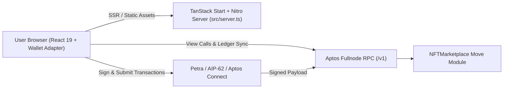

# ORBIX.NFT

Decentralized NFT and digital assets marketplace for ocean-themed collectibles on the Aptos blockchain, built with Aptos Move smart contracts, React 19, TanStack Start, Tailwind CSS v4, and Nitro.

- **Repository:** https://github.com/vismaygawai/orbix.nft
- **Author & Maintainer:** Vismay

---

## Table of Contents

1. [Project Overview](#project-overview)
2. [Problem Statement & Objectives](#problem-statement--objectives)
3. [Core Features](#core-features)
4. [Technology Stack](#technology-stack)
5. [System Architecture](#system-architecture)
6. [Repository Structure](#repository-structure)
7. [Prerequisites](#prerequisites)
8. [Installation & Environment Configuration](#installation--environment-configuration)
9. [Local Development Setup](#local-development-setup)
10. [Wallet Integration & Supported Networks](#wallet-integration--supported-networks)
11. [Smart Contract Reference (`NFTMarketplace.move`)](#smart-contract-reference-nftmarketplacemove)
12. [NFT Metadata, Media & Storage](#nft-metadata-media--storage)
13. [Marketplace Functionality](#marketplace-functionality)
14. [Testing & Verification](#testing--verification)
15. [Production Build & Deployment](#production-build--deployment)
16. [Security Practices](#security-practices)
17. [Troubleshooting & Known Limitations](#troubleshooting--known-limitations)
18. [License](#license)
19. [Author & Maintainer](#author--maintainer)

---

## Project Overview

**ORBIX.NFT** is a non-custodial Web3 NFT marketplace and auction platform operating on Aptos. Rather than relying on a centralized application database for listings, bids, or royalties, marketplace state and escrow logic are implemented directly in the `NFTMarketplace` Move module (`contracts/sources/NFTMarketplace.move`), while the frontend is served through TanStack Start SSR and Nitro.

The platform also includes a curated showcase of three hero ocean artifacts (`Orby`, `Orix`, and `Orbix`) stored with local poster/video assets in `public/videos/`. When the Move marketplace module is initialized on the configured network, full on-chain minting, direct listings, auctions, escrowed offers, transfers, royalties, and analytics operate directly against the Aptos fullnode RPC.

---

## Problem Statement & Objectives

Conventional digital collectibles platforms often introduce opaque custodial escrow, off-chain order books, and inconsistent royalty enforcement. ORBIX.NFT addresses these gaps with the following engineering objectives:

- **Non-Custodial On-Chain Escrow:** Lock auction bids and buyer offers in Move `Table<..., Coin<AptosCoin>>` escrow resources until settled, outbid, rejected, or cancelled.
- **Atomic Settlement & Royalties:** Deduct the 2% protocol fee and configured creator royalty (0%–30%) atomically during direct purchases, auction finalizations, and offer acceptances.
- **Accessible Onboarding:** Support both browser extension wallets (Petra and AIP-62 compatible extensions) and Aptos Connect keyless Google login behind an SSR-safe provider boundary.
- **Client-Side Safety & Precision:** Perform Octas arithmetic with `BigInt` (`1 APT = 10^8 Octas`), enforce network alignment before signing, sanitize media URIs, and apply HTTP security headers across SSR and Vercel deployments.

---

## Core Features

- **Artifact Minting:** Mint new digital artifacts on-chain with bounded UTF-8 names (1–128 bytes), descriptions (0–1024 bytes), sanitized `https://` or `ipfs://` media URIs (1–512 bytes), and rarity tiers (1: Common, 2: Uncommon, 3: Rare, 4: Epic).
- **Fixed-Price Marketplace (`/market`):** Browse, search, filter by rarity, sort by ID or price, list owned artifacts (`list_for_sale`), update prices (`set_price`), delist (`cancel_listing`), and purchase (`purchase_nft`).
- **On-Chain Auctions (`/market`):** Create timed auctions (1 hour to 30 days), place bids with automatic refund of the prior highest bidder (`place_bid`), cancel empty auctions early, and settle expired auctions (`finalize_auction`).
- **Escrowed Offers (`/my-nfts` & artifact modals):** Submit time-bounded offers (`make_offer`), accept incoming offers (`accept_offer`), reject offers (`reject_offer`), and cancel pending or expired offers (`cancel_offer`).
- **Direct Transfers:** Transfer unlisted, non-auctioned artifacts directly to another Aptos address (`transfer_ownership`) with two-step confirmation and zero-address / self-transfer guards.
- **Creator Royalties (`/royalties`):** Configure perpetual secondary-sale royalties between 0% and 30% (`set_creator_royalty`).
- **Marketplace Analytics (`/analytics`):** Visualize total volume, completed sales, active listings, sales by rarity, and historical volume via Recharts.

---

## Technology Stack

| Layer                    | Technology                                                                                                                                |
| ------------------------ | ----------------------------------------------------------------------------------------------------------------------------------------- |
| Frontend Framework       | React 19, TypeScript 5, TanStack Start, TanStack Router, TanStack Query                                                                   |
| Styling & UI             | Tailwind CSS v4, Radix UI primitives, `lucide-react`, `sonner`, `recharts`                                                                |
| Blockchain SDK & Wallets | `aptos` v1 SDK (`AptosClient`), `@aptos-labs/wallet-adapter-react`, `petra-plugin-wallet-adapter`, `@aptos-connect/wallet-adapter-plugin` |
| Smart Contracts          | Aptos Move (`contracts/sources/NFTMarketplace.move`)                                                                                      |
| Build & SSR Runtime      | Vite 8, Nitro (`node-server` and `vercel` presets)                                                                                        |
| Testing & Tooling        | Vitest 4, React Testing Library, `jsdom`, ESLint 9, Prettier 3                                                                            |

---

## System Architecture



- **Server Entry & Middleware:** `src/start.ts` configures TanStack Start's CSRF middleware (`serverFn`) and error-handling middleware; `src/server.ts` normalizes SSR errors and attaches HTTP security headers (`Content-Security-Policy`, `Strict-Transport-Security`, `X-Frame-Options`, `X-Content-Type-Options`, `Referrer-Policy`, `Permissions-Policy`).
- **SSR Hydration Isolation:** `src/components/wallet/AptosWalletProvider.tsx` keeps the React context tree intact on SSR while instantiating browser-dependent wallet plugins (`PetraWallet`) only after client hydration.
- **Ledger Clock Synchronization:** `syncLedgerTime()` queries `getLedgerInfo()` on mount so auction countdowns and offer expiration checks account for local clock drift.

---

## Repository Structure

```text
orbix.nft/
├── .github/workflows/ci.yml           # GitHub Actions lint, typecheck, test, and build workflow
├── contracts/
│   ├── Move.toml                      # Aptos Move package manifest and address binding
│   └── sources/NFTMarketplace.move    # Marketplace, auction, offer escrow, and royalty module
├── public/
│   ├── videos/                        # Showcase MP4 videos and WebP poster assets
│   ├── favicon.ico                    # Site favicon
│   └── robots.txt                     # Crawler rules
├── src/
│   ├── components/
│   │   ├── marketplace/               # NFTCard, AuctionCard, LazyMedia, and transaction modals
│   │   ├── ui/                        # Radix UI + Tailwind primitives
│   │   ├── wallet/                    # AptosWalletProvider and WalletButton
│   │   ├── Footer.tsx                 # Footer with contract link, privacy, and terms dialogs
│   │   └── NavBar.tsx                 # Responsive navigation header and mint trigger
│   ├── hooks/
│   │   ├── useMarketplaceTx.ts        # Network-enforced transaction submission & confirmation hook
│   │   └── use-mobile.tsx             # Viewport breakpoint hook
│   ├── lib/
│   │   ├── aptosClient.ts             # Validated env config, Octas math, URI/address sanitization, Move error map
│   │   ├── curatedNFTs.ts             # Curated hero artifacts registry with validated localStorage persistence
│   │   ├── error-capture.ts           # Server error capture helper for Nitro/h3 SSR
│   │   ├── error-page.ts              # Fallback 500 HTML page
│   │   └── utils.ts                   # Tailwind class merge helper
│   ├── routes/
│   │   ├── __root.tsx                 # Root document shell, providers, ledger sync, and error boundaries
│   │   ├── index.tsx                  # Landing page
│   │   ├── market.tsx                 # Direct listings & live auctions explorer
│   │   ├── my-nfts.tsx                # Owned artifacts, incoming offers, and outgoing offer escrow
│   │   ├── analytics.tsx              # On-chain volume and rarity analytics
│   │   └── royalties.tsx              # Creator royalty configuration page
│   ├── test/                          # Vitest unit and routing test suites
│   ├── types/marketplace.ts           # TypeScript domain interfaces
│   ├── router.tsx                     # TanStack Router configuration
│   ├── server.ts                      # Nitro server entry with security headers
│   ├── start.ts                       # TanStack Start request/CSRF middleware setup
│   └── styles.css                     # Tailwind CSS v4 theme tokens and custom styles
├── .env.example                       # Environment variable template
├── eslint.config.js                   # ESLint flat config with Prettier & TanStack Start rules
├── package.json                       # Project manifest, dependencies, and scripts
├── tsconfig.json                      # Strict TypeScript compiler options
├── vercel.json                        # Vercel build config and HTTP security headers
├── vite.config.ts                     # Vite + TanStack Start + Nitro configuration
└── vitest.config.ts                   # Vitest + jsdom test configuration
```

---

## Prerequisites

- **Node.js:** v20.x or newer (CI uses Node 20)
- **Package Manager:** `pnpm` (`packageManager: pnpm@10.32.1`)
- **Aptos CLI (optional, for Move contract compilation/testing):** Aptos CLI with Move compiler
- **Wallet (optional, for live transactions):** Petra browser extension or Google account for Aptos Connect

---

## Installation & Environment Configuration

1. Clone the repository and install dependencies:

   ```bash
   git clone https://github.com/vismaygawai/orbix.nft.git
   cd orbix.nft
   pnpm install --frozen-lockfile
   ```

2. Create a local environment file from the template:

   ```bash
   cp .env.example .env
   ```

3. Configure environment variables in `.env` (defaults are validated in `src/lib/aptosClient.ts`):

   | Variable                            | Description                                                                       | Default Fallback                                                     |
   | ----------------------------------- | --------------------------------------------------------------------------------- | -------------------------------------------------------------------- |
   | `VITE_APTOS_NODE_URL`               | Aptos fullnode REST endpoint (`https://`, or `http://localhost` for local devnet) | `https://fullnode.devnet.aptoslabs.com/v1`                           |
   | `VITE_APTOS_NETWORK`                | Target Aptos network (`devnet`, `testnet`, `mainnet`, or `local`)                 | `devnet`                                                             |
   | `VITE_MARKETPLACE_CONTRACT_ADDRESS` | Hex address where `NFTMarketplace` is published                                   | `0x4bee16faf06f7ffb1968c3b7baad06a651a80de4e5a620be45aa45853d23f6fb` |

---

## Local Development Setup

Start the Vite + TanStack Start development server:

```bash
pnpm dev
```

Available application routes:

- `/` — Landing showcase and hero collection overview
- `/market` — Direct fixed-price listings and live auctions
- `/my-nfts` — Connected wallet portfolio, incoming offers, and outgoing escrowed offers
- `/analytics` — Marketplace volume, sales count, and rarity charts
- `/royalties` — Creator royalty rate configuration (0%–30%)

---

## Wallet Integration & Supported Networks

- **Supported Wallets:**
  - **Petra Wallet** (`petra-plugin-wallet-adapter`) and AIP-62 standard browser wallets.
  - **Aptos Connect / Google Keyless** (`Continue with Google` via `@aptos-connect/wallet-adapter-plugin`).
- **Supported Networks:** `devnet`, `testnet`, `mainnet`, and `local` (configured via `VITE_APTOS_NETWORK`).
- **Network Safety:** `useMarketplaceTx` verifies that the connected wallet's reported network matches `APTOS_NETWORK` and blocks transaction submission on mismatch.

---

## Smart Contract Reference (`NFTMarketplace.move`)

The Move module resides in `contracts/sources/NFTMarketplace.move` under named address `NFTMarketplace` (`0x4bee16faf06f7ffb1968c3b7baad06a651a80de4e5a620be45aa45853d23f6fb` in `contracts/Move.toml`).

> **Note:** On-chain deployment status on external networks is not independently verified at runtime unless queried against an initialized Aptos fullnode. Check `is_marketplace_initialized` against your target RPC before submitting contract entry calls.

### Constants

- `MARKETPLACE_FEE_PERCENT`: `2` (2%)
- `MIN_AUCTION_DURATION`: `3600` seconds (1 hour)
- `MAX_AUCTION_DURATION`: `2592000` seconds (30 days)
- `MAX_OFFER_DURATION`: `2592000` seconds (30 days)
- `MAX_CREATOR_ROYALTY_PERCENT`: `30` (30%)

### Entry Functions

| Function              | Description                                                                                                     |
| --------------------- | --------------------------------------------------------------------------------------------------------------- |
| `initialize`          | Initializes the `Marketplace` resource, escrow tables, stats, and event handles under the signer.               |
| `mint_nft`            | Mints an artifact with bounded `name` (1–128 B), `description` (<=1024 B), `uri` (1–512 B), and `rarity` (1–4). |
| `list_for_sale`       | Lists an owned, non-auctioned artifact at a positive price in Octas.                                            |
| `cancel_listing`      | Removes an active fixed-price listing.                                                                          |
| `set_price`           | Updates the asking price of an active listing.                                                                  |
| `purchase_nft`        | Transfers payment (2% fee + optional creator royalty + seller proceeds) and updates ownership.                  |
| `transfer_ownership`  | Transfers an owned, non-auctioned artifact to a non-zero, non-self address.                                     |
| `create_auction`      | Starts a timed auction (`MIN_AUCTION_DURATION` to `MAX_AUCTION_DURATION`), delisting any fixed-price listing.   |
| `place_bid`           | Escrows a higher `AptosCoin` bid and refunds the prior highest bidder.                                          |
| `finalize_auction`    | Settles an ended auction (or cancels an empty auction early by the seller).                                     |
| `set_creator_royalty` | Sets the caller's secondary-sale royalty percentage (0%–30%).                                                   |
| `make_offer`          | Escrows `AptosCoin` for a time-bounded offer.                                                                   |
| `accept_offer`        | Transfers the artifact and distributes escrowed funds (fee, royalty, seller proceeds).                          |
| `cancel_offer`        | Refunds a buyer's pending or expired offer from escrow.                                                         |
| `reject_offer`        | Allows the NFT owner to reject a pending offer and refund the buyer.                                            |

### View Functions

`is_marketplace_initialized`, `get_nft_details`, `is_nft_for_sale`, `get_nft_price`, `get_owner`, `get_all_nfts_for_owner`, `get_all_nfts_for_sale`, `is_in_auction`, `get_nft_creator`, `get_total_nfts`, `get_nfts_by_rarity`, `get_marketplace_stats`, `get_sales_by_rarity`, `get_active_auctions`, `get_offers_for_nft`, `get_user_offers`, `get_creator_royalty`.

---

## NFT Metadata, Media & Storage

- **On-Chain Metadata:** `NFT` structs store `name`, `description`, `uri`, `price`, `for_sale`, and `rarity` inside `Marketplace.nfts`.
- **URI Sanitization:** `sanitizeMediaUri` and `resolveMediaUrl` allow only local relative `/` paths (without `//` or `..`), validated `ipfs://` paths (resolved to `https://ipfs.io/ipfs/...`), and `https://` URLs without embedded credentials. Dangerous schemes (`javascript:`, `data:`, `vbscript:`) and cleartext `http://` URLs are stripped to `""`.
- **Curated Showcase Fallback:** `src/lib/curatedNFTs.ts` provides the three showcase artifacts (`Orby`, `Orix`, `Orbix`) using local assets in `public/videos/` and validates `localStorage` entries on read. Curated off-chain showcase items (`onChain: false`) are blocked from triggering on-chain Move contract mutations (`make_offer`, `create_auction`, `transfer_ownership`, `list_for_sale`) so off-chain showcase IDs cannot collide with on-chain tokens.

---

## Marketplace Functionality

- **Financial Precision:** All APT/Octas conversions use `octasToApt`, `aptToOctas`, and `aptToOctasBigInt` (`1 APT = 100,000,000 Octas`) with non-scientific decimal parsing and `Number.MAX_SAFE_INTEGER` overflow guards.
- **Transaction Lifecycle:** `useMarketplaceTx` checks wallet connection, enforces `APTOS_NETWORK` alignment, submits the transaction via the connected wallet adapter, waits for on-chain confirmation via `waitForTransactionWithResult`, maps Move VM abort codes (`MOVE_ERROR_MAP`), and notifies listeners via `orbix:nft-updated`.

---

## Testing & Verification

Run linting, TypeScript checks, and the Vitest suite:

```bash
pnpm lint
npx tsc --noEmit
pnpm test
```

Format code with Prettier:

```bash
pnpm format
```

If Aptos CLI is installed locally, compile and run Move contract unit tests:

```bash
cd contracts
aptos move test
```

---

## Production Build & Deployment

Build client and SSR server bundles:

```bash
pnpm build
```

Preview locally via Vite or run the Nitro Node server output:

```bash
pnpm preview
# or after `pnpm build`:
node .output/server/index.mjs
```

### Vercel Deployment

`vercel.json` configures Vercel with `framework: "tanstack-start"`, `buildCommand: "pnpm build"`, `installCommand: "pnpm install"`, and HTTP security headers. When `VERCEL` is set in the build environment, `vite.config.ts` selects Nitro's `vercel` preset automatically; otherwise it defaults to `node-server` (overridable via `NITRO_PRESET`).

---

## Security Practices

- **Network Mismatch Blocking:** Transactions are aborted client-side if the connected wallet network differs from `VITE_APTOS_NETWORK`.
- **Strict URI & Address Validation:** `normalizeAddress`, `isValidAptosAddress`, `sanitizeMediaUri`, and `resolveMediaUrl` reject malformed hex strings, zero addresses, traversal segments, credentials in URLs, and scriptable URI schemes.
- **HTTP Security Headers & CSRF:** `src/start.ts` enables TanStack Start CSRF middleware for `serverFn` handlers; both `src/server.ts` and `vercel.json` apply `Content-Security-Policy`, `Strict-Transport-Security`, `X-Frame-Options: DENY`, `X-Content-Type-Options: nosniff`, `Referrer-Policy`, and `Permissions-Policy`.
- **No Embedded Secrets:** All frontend configuration uses public `VITE_*` variables with no private keys or backend credentials in the repository.

---

## Troubleshooting & Known Limitations

- **Unbounded Vector Scans in Move:** `Marketplace.nfts`, `Marketplace.auctions`, and `Marketplace.stats.sales_history` are stored in `vector` fields; very large collections will eventually increase gas for `get_user_offers` and `has_active_auction`.
- **Single-Page Fetch Cap:** `market.tsx` and `my-nfts.tsx` currently query up to `100` items (`limit = 100, offset = 0`) per view call.
- **Move Coin Registration:** `NFTMarketplace.move` uses `aptos_framework::coin::transfer` / `coin::deposit`, which requires recipient accounts to have `CoinStore<AptosCoin>` registered.
- **Curated Showcase State:** Purchases of off-chain curated showcase items update local browser state (`localStorage`) after a native `0x1::aptos_account::transfer` and are not indexed across devices until minted via the Move contract.

---

## License

This project is licensed under the MIT License. Third-party open-source dependencies retain their respective licenses and copyright notices.

---

## Author & Maintainer

**Vismay** — Sole Author & Project Maintainer  
GitHub: https://github.com/vismaygawai/orbix.nft
